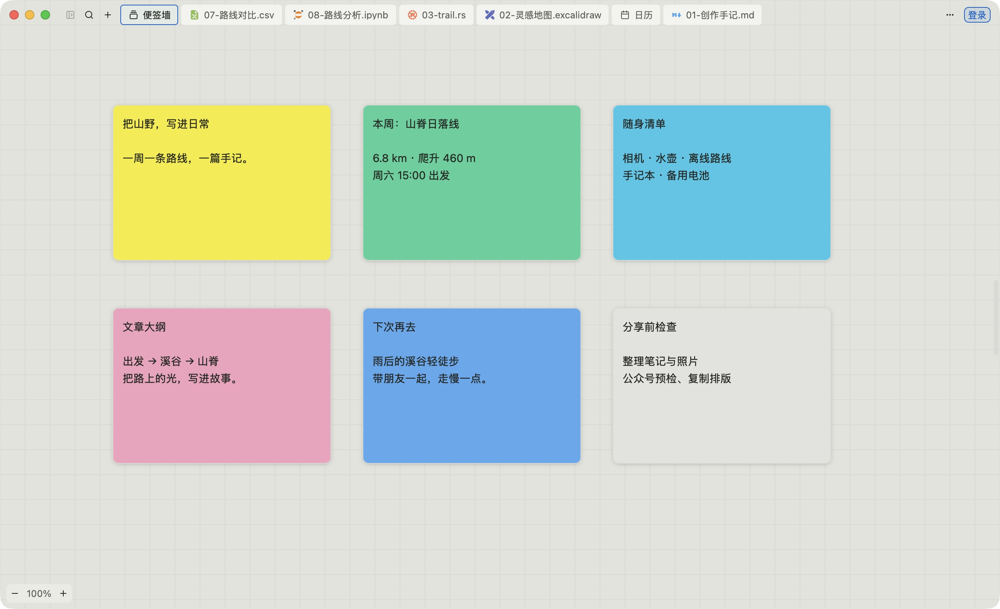
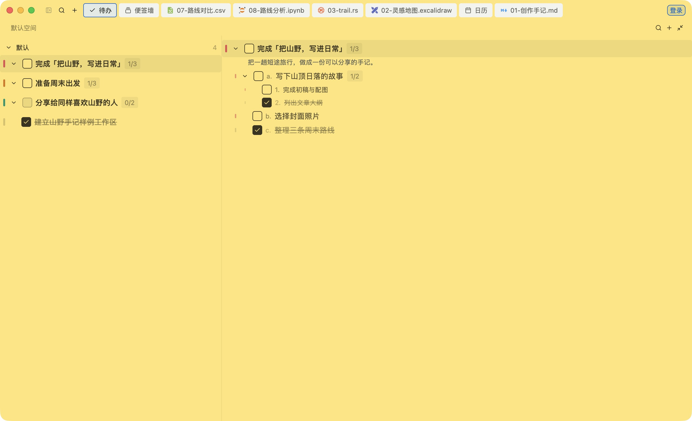
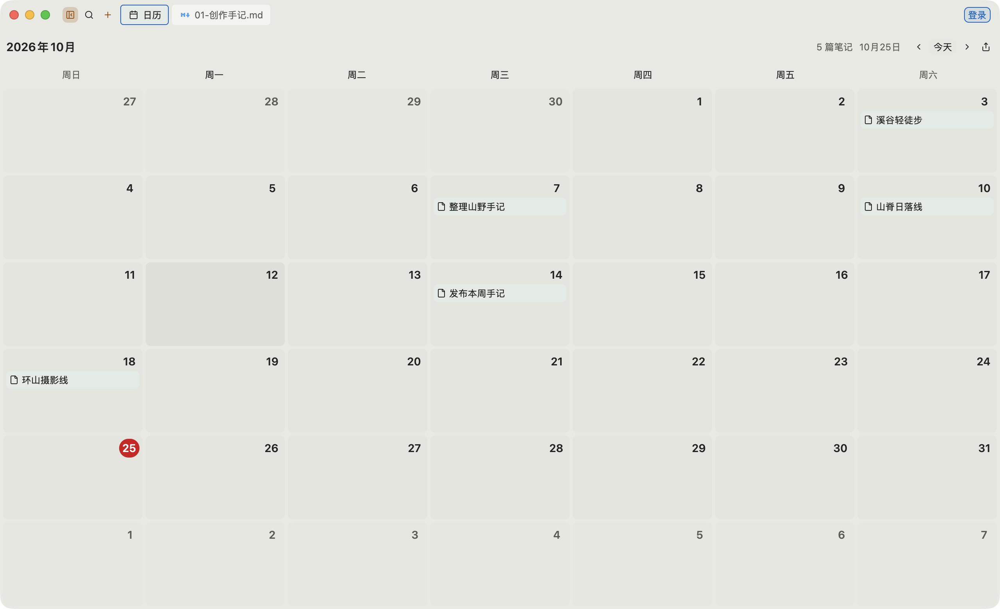
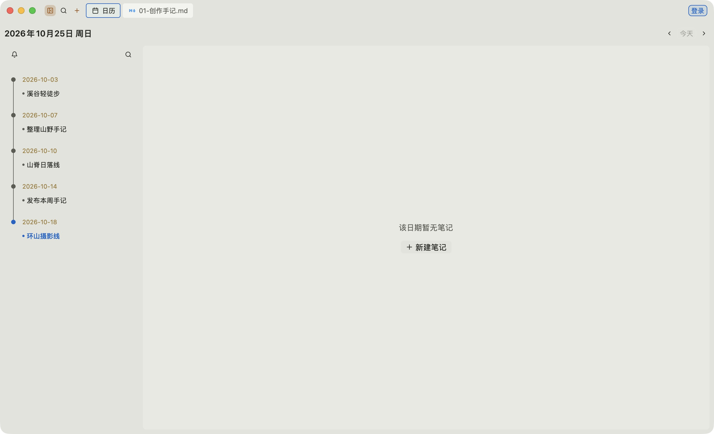
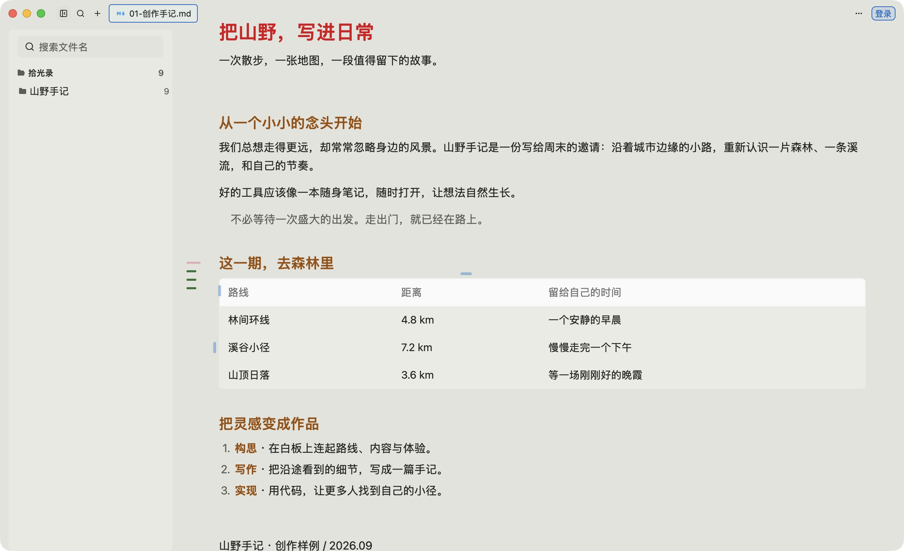
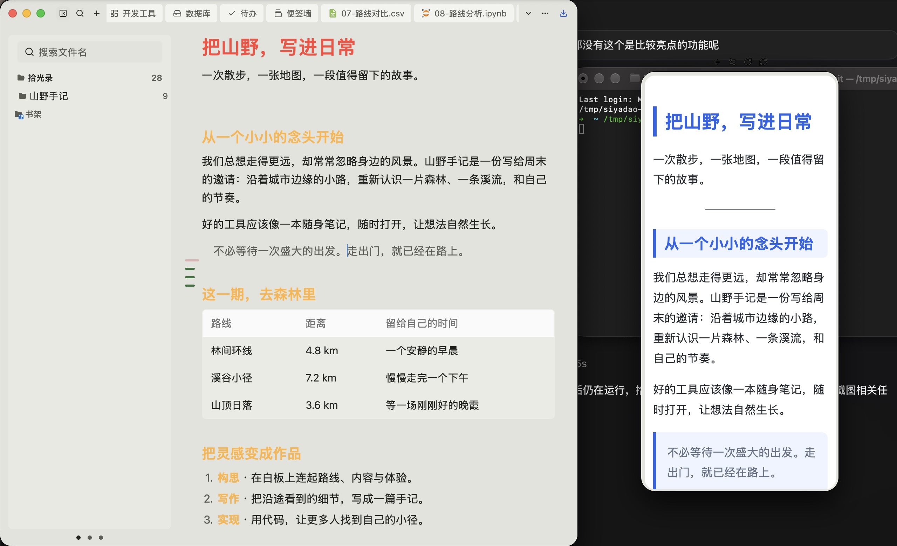
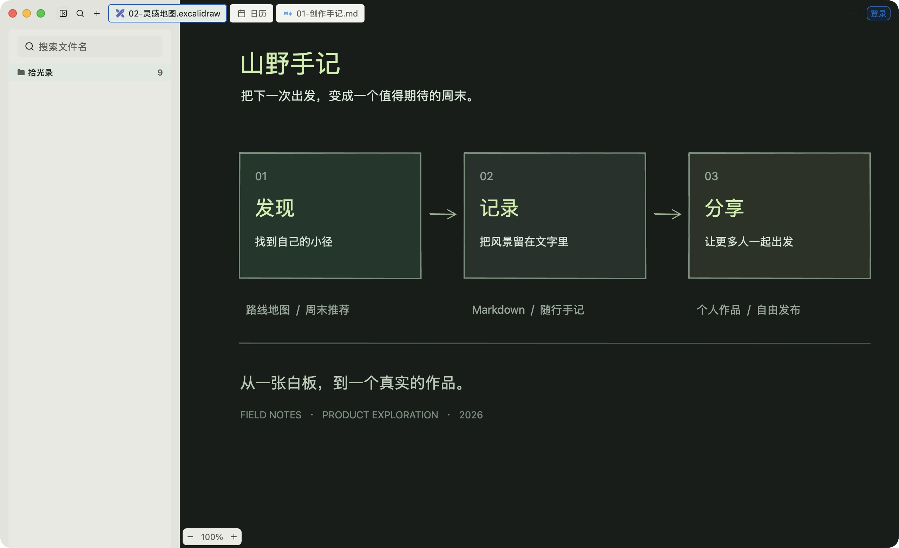
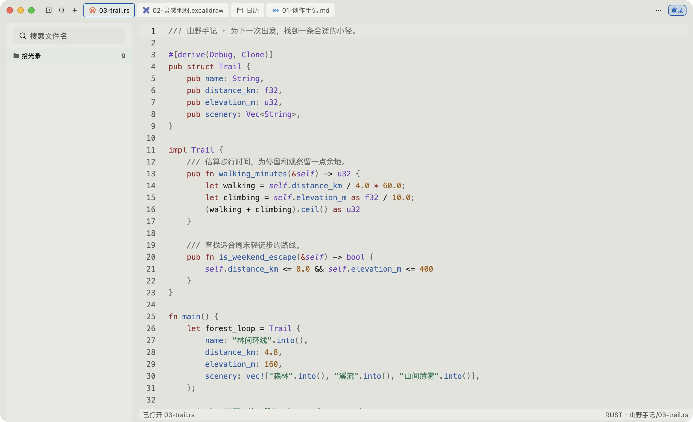
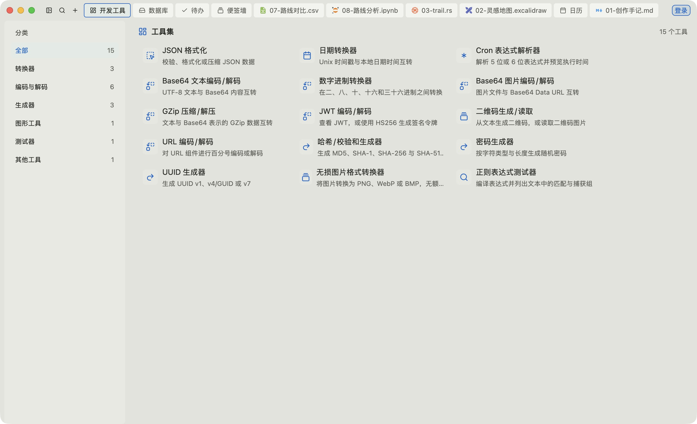
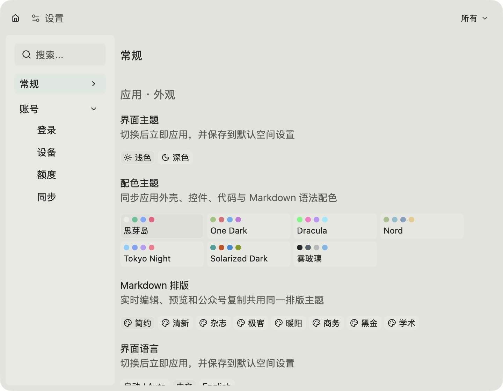

# 思芽岛 · Studio

**原生创作工作台。** 便签、待办、日历与笔记时间线，连接写作、白板、代码、数据和自动化。个人空间可离线使用；需要时再登录并按类同步。

本仓库**只分发安装包、版本说明与问题反馈**，不含应用源码。GitHub 自动生成的 Source code 附件对应本分发仓，不是安装包。

  

  <a href="https://studio.siyadao.cn/">产品介绍</a>
  ·
  <a href="https://github.com/siyadao/studio/releases">Releases 安装包</a>
  ·
  <a href="https://studio.siyadao.cn/#download">官网下载菜单</a>
  ·
  <a href="https://github.com/siyadao/studio/issues">问题反馈</a>

截图为应用实拍（与 [siyadao.github.io](https://github.com/siyadao/siyadao.github.io) 同源演示空间），便于在本仓 README 内预览。

---

## 日常与创作

| 便签 | 待办 |
| :---: | :---: |
|  |  |

| 日历 | 时间线 |
| :---: | :---: |
|  |  |

  

  

| 白板 | 代码 |
| :---: | :---: |
|  |  |

  
  

更多场景与深色主题见 [产品官网](https://studio.siyadao.cn/) / [英文站](https://siyadao.github.io/)。

---

## 下载

请到 **[Releases](https://github.com/siyadao/studio/releases)** 的 Assets 中选择当前版本已发布的平台包（各版本附件可能不同，以页面为准）。官网下载菜单也会列出公开发布的安装包。

常见文件名形态：

| 平台 | 典型附件 |
| --- | --- |
| macOS Apple silicon | `siyadao-v*-macos-arm64.dmg` |
| macOS Intel | `siyadao-v*-macos-x64.dmg` |
| Windows x64 | `siyadao-v*-windows-x64-setup.exe` 或 `.zip` |
| Windows ARM64 | `siyadao-v*-windows-arm64-setup.exe` |
| Linux | `siyadao-v*-linux-*-*.AppImage` 等（若该版已发布） |

安装提示：

- **macOS**：打开 DMG，将应用拖入 Applications。
- **Windows**：运行 Setup，或解压便携包后启动 `siyadao.exe`；请勿移除包内模型 Worker、MCP 桥接、PDFium 与运行库。
- 标记 **Pre-release** 的为测试版。未公证 / 未签名的测试包可能触发系统安全提示：请核对来源及同版本 `SHA256SUMS`（若有），不要关闭系统安全防护。

---

## 测试与反馈

请先备份工作区，用临时目录或数据副本验证启动、保存、日历、待办、便签、魔法球与开发工具。版本限制与第三方许可见包内说明及该次 Release 说明。

提 [Issue](https://github.com/siyadao/studio/issues) 时请写明包名、系统版本、复现步骤；可附必要截图。**不要**上传密码、令牌、私钥或敏感工作区内容。
